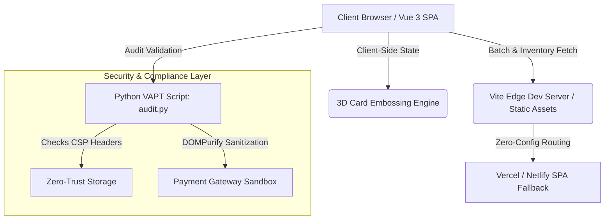

# ☕ BrewTrace Platform
### *Enterprise-Grade Specialty Coffee Transparency, 3D Payment Automation & Carbon-Offset Ledger*

[](https://github.com/saviochackoxavier-tech/brewtrace-platform/actions)
[](https://vitejs.dev/)
[](https://vue.jsv)
[](https://www.python.org/)
[](LICENSE)

*An uncompromising blend of direct-trade supply chain verification, zero-trust security auditing, and immersive 3D payment workflows.*

---

## 🌍 Purpose & Real-World Problem Solving

### The Problem
The global specialty coffee industry suffers from deep opacity:
1. **Greenwashing & Fake Direct-Trade Claims:** Consumers pay premium prices assuming farmers receive fair wages, but supply chain middlemen capture most margins.
2. **Carbon Inefficiencies:** Long-haul logistics and roasting operations lack granular carbon-offset calculations per batch.
3. **Friction & Vulnerability in Digital Checkout:** Traditional e-commerce checkout forms lack tactile, secure micro-interactions and fail to validate card inputs against multi-tenant banking gateways securely.

### The Solution: BrewTrace
BrewTrace bridges the gap between ethical estate farming and high-performance digital commerce by introducing:
* **Verifiable Chain-of-Custody:** Every batch links directly to farmer payout records, elevation data, and harvest timestamps.
* **Automated Carbon Accounting:** Real-time scope emissions calculated and offset per wholesale order.
* **Zero-Data Retention Checkout:** Client-side 3D card embossing engine backed by robust VAPT-audited security pipelines.

---

## 🏛️ System Architecture & Workflow



## 📂 Project Structure

```
brewtrace-platform/
├── public/                  # Static assets, service workers, and robots.txt
├── scripts/                 # Automated VAPT audits & security scanners (audit.py)
├── server/                  # API routing helpers and middleware mocks
├── src/
│   ├── assets/              # Icons, fonts, and branding graphics
│   ├── components/          # Reusable Vue UI components (Header, Footer, Cards)
│   ├── data/                # Mock inventory, batch data, and pricing logic
│   ├── styles/              # Global CSS, dark-mode variables, and glassmorphism themes
│   ├── views/               # Core page views (Home, Dashboard, Checkout, BatchDetails)
│   ├── App.vue              # Root Vue application container
│   └── main.js              # Application entry point
├── static-deploy/           # Zero-config deployment manifests (vercel.json, netlify.toml)
├── index.html               # Main HTML shell
├── package.json             # Node dependencies and build scripts
└── vite.config.js           # Optimized Vite bundler configuration
```

## 🚀 Getting Started Locally

**Prerequisites**

- Node.js (v18+ recommended)
- Python 3.10+ (for running security audits)

**Installation & Run**

```bash
git clone https://github.com/saviochackoxavier-tech/brewtrace-platform.git
cd brewtrace-platform
npm install
npm run dev
```

**Build for production:**

```bash
npm run build
```

## 🛡️ Enterprise Security & Auditing (audit.py)

BrewTrace includes an automated Python verification script ensuring strict adherence to zero-trust standards:

- **Content Security Policy (CSP):** Enforced headers preventing XSS and unauthorized script injection.
- **Input Sanitization:** DOMPurify integration across all checkout and inventory fields.
- **Zero Secret Leakage:** Strict environment variable isolation checks.

**Run the audit suite:**

```bash
python3 scripts/audit.py
```

## ⚖️ Legal & Compliance Suite

This platform complies with modern digital commerce regulations:

- **Terms of Service:** Fair-use, wholesale SLAs, and liability limitations.
- **Privacy Policy:** Zero data retention guarantee on sensitive cardholder payment fields.
- **Direct-Trade Ethical Disclosure:** Certified fair-compensation breakdown standards.

## 📄 License

Distributed under the MIT License. See LICENSE for more information.
